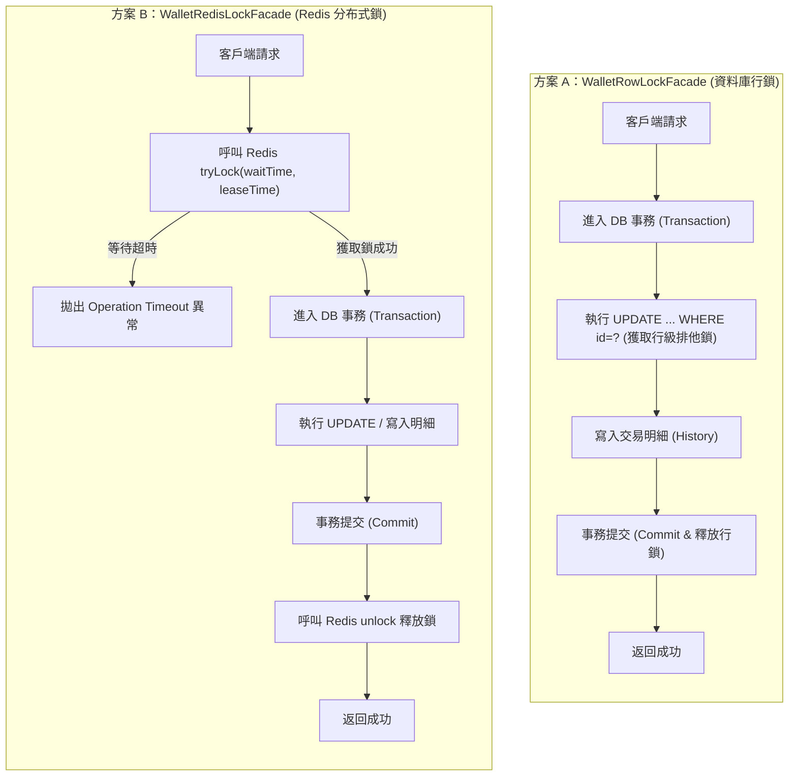

# Wallet 併發交易與鎖策略壓測效能總結報告 (Concurrency & Locking Benchmark)

本專案旨在評估與對比在高併發交易情境下，Wallet 系統採用兩種核心併發控制策略的效能與穩定性表現：
1. **資料庫行鎖門面 (`WalletRowLockFacade`)**
2. **Redis 分布式鎖門面 (`WalletRedisLockFacade`)**

同時橫向評測兩者在主流關聯式資料庫 **MySQL (InnoDB)** 與 **PostgreSQL** 上的極限吞吐量與延遲差異。

---

## 📌 1. 核心結論先講 (Executive Summary)

### 1.1 一句話決策建議
> **Wallet 核心即時交易主路徑「強烈建議以資料庫 RowLock 為主」**。  
> 分布式鎖（Redis Lock）在資料庫已具備 ACID 保障的單體寫入情境下，不僅無法提供額外保護，反而會因**外部網路往返、鎖排隊與鎖移交耗時**，在高競爭下演變為嚴重的延遲膨脹與大量 `operation timeout`。

### 1.2 關鍵發現矩陣

| 比較維度 | 核心發現與實測結論 | 關鍵指標證據 |
| :--- | :--- | :--- |
| **MySQL 內部：<br>RowLock vs RedisLock** | **RowLock 全面勝出**。<br>在所有核心場景（極端熱點、高競爭、低競爭吞吐），RowLock 的 TPS 均高出 **1.5x ~ 3.3x**，且耗時更短、成功率穩定維持 100%。 | 熱點帳戶 (`accounts=2`)：<br>• RowLock TPS 約 **740**，成功率 **100%**<br>• RedisLock TPS 僅 **224~246**，高併發下超時率高達 **14.5%** |
| **資料庫對比：<br>MySQL vs PostgreSQL** | **PostgreSQL 吞吐能力更強**。<br>在相同硬體與 workload 下，PostgreSQL 處理高併發分散寫入與鎖調度效率顯著高於 MySQL，TPS 領先約 **40% ~ 100%**。 | 分散帳戶 (`accounts=10000`) RowLock：<br>• MySQL TPS 最高約 **9,841**<br>• PostgreSQL TPS 最高達 **16,652** |
| **跨資料庫鎖策略共通性** | 不論是 MySQL 還是 PostgreSQL，**兩者的最佳實踐均為 `RowLock`**。資料庫選型不影響「即時交易主路徑應走行鎖」的核心結論。 | 兩資料庫中，RedisLock 均因額外協調成本造成 TPS 明顯劣於 RowLock。 |
| **Timeout 真相診斷** | RedisLock 出現的 `operation timeout` **並非 DB 寫入崩潰**，而是請求在進入 DB 前，於 Redis 的 `tryLock(waitTime, leaseTime)` **等待時間被耗盡**。 | 發生超時時，DB 內部 `updateBalanceAvgMs` 並未飆升，而 `getLockAvgMs` 與 `redisTotalAvgMs` 呈指數級暴增。 |
| **批次場景 (`BATCH_CASH_IN`)** | 批次寫入能攤平鎖開銷，當帳戶分散時 RedisLock TPS 可逼近 RowLock；但**一旦回歸熱點帳戶，批次反而加速 Redis 鎖等待超時崩潰**。 | `accounts=2, batchSize=1000` 時：<br>• RowLock 成功率 **100%**<br>• RedisLock 超時率飆至 **76%**（成功率僅 24%） |

---

## 🏗️ 2. 兩種併發控制方案架構對比



### 2.1 方案特性詳細比對

| 特性維度 | 行鎖門面 (`WalletRowLockFacade`) | 分布式鎖門面 (`WalletRedisLockFacade`) |
| :--- | :--- | :--- |
| **核心 SQL 機制** | `UPDATE wallet SET balance = balance + ? WHERE id = ?`<br>`UPDATE wallet SET balance = balance - ? WHERE id = ? AND balance >= ?` | 先透過 Redis 獲取 key 互斥鎖，再進入 DB 執行更新事務。 |
| **一致性邊界 (Boundary)** | 鎖、資料、交易皆收斂於**單一資料庫實例內部**。 | 鎖在外部快取層（Redis），資料交易在資料庫內部，跨兩套系統。 |
| **網路往返開銷 (RTT)** | **0 額外網路跳轉**，請求直接進入 DB 連線。 | 增加至少 **2 次額外網路呼叫**（Acquire Lock + Release Lock）及高併發重試開銷。 |
| **鎖移交機制 (Handoff)** | 在資料庫記憶體（Engine Memory / Latches）內部快速喚醒排隊事務。 | 依賴應用層輪詢（Polling/Spin）、Redis Pub/Sub 與外部網路往返傳遞。 |
| **主要成本與瓶頸** | 資料庫 CPU 與單行更新序列化等待。 | 外部網路延遲、Redis 鎖競爭排隊、線程上下文切換與超時耗盡。 |
| **最合適場景** | **單一資料庫 ACID 邊界內的資金即時扣除/加款（推薦）**。 | 跨微服務、跨獨立資料庫、涉及第三方支付 Gateway 的跨系統防重複調用。 |

---

## 🧪 3. 測試環境與數據來源 (Benchmark Setup)

### 3.1 測試數據集依據
本次測試涵蓋兩大維度，數據完全採集自 `stress-results/` 目錄下的標準壓測結果：
1. **MySQL 內部完整對比與補測**：
   - `mysql-20260630-210119.csv`：最新完整基準，涵蓋 `threads = 20 / 200 / 500` 及 `BATCH_CASH_IN` 批次場景。
   - `mysql-20260629-214815.csv`：高線程壓力測試（`threads = 100 / 500 / 1000`，`totalOps = 10k ~ 100k`）。
   - `mysql-20260629-143504.csv`：極限單帳戶場景（`accounts = 1`）。
2. **MySQL vs PostgreSQL 成對跨庫對照**：
   - `mysql-20260629-115912.csv` 與 `postgres-20260629-125819.csv`（相同時間段、相同工作負載、完整成對基準）。

### 3.2 關鍵指標定義
- **TPS (Transactions Per Second)**：每秒完成之有效交易總數（越大越好）。
- **durationMs**：完成該批次全部總操作數 (`totalOps`) 的總耗時毫秒數（越小越好）。
- **directAvgMs**：業務 Facade 方法的平均實際執行耗時（越小越好）。
- **successRatio**：請求成功率（目標為 100%）。
- **operationTimeoutRatio / Count**：因 Redis `tryLock` 等待時間耗盡而拋出超時的比例與總次數。
- **retries**：Redis 鎖獲取過程中的重試排隊次數。

---

## 📊 4. 實測數據對比與深度判讀 (Empirical Benchmark Results)

### 4.1 MySQL：RowLock vs RedisLock 全場景實測

#### 場景 A：極端熱點單帳戶 (`accounts = 1`, 極限單 Key 爭搶)
> **條件**：`totalOps = 10,000`，`threads = 20`（所有線程瘋狂爭搶同一個帳戶 ID）

| 鎖策略 | TPS | 總耗時 (`durationMs`) | 方法執行耗時 (`directAvgMs`) | 成功率 | 超時率 | 鎖重試次數 (`retries`) |
| :--- | :---: | :---: | :---: | :---: | :---: | :---: |
| **RowLock** | **315.29** | **31,717 ms** | **62.76 ms** | **100.00%** | **0.00%** | 0 (DB 內排隊) |
| **RedisLock** | 96.73 | 101,399 ms | 160.07 ms | 98.08% | 1.92% (192次) | 9,342 次 |
| **差異比值** | **RowLock 3.26x 🚀** | **RowLock 快 3.2x** | **RowLock 快 2.5x** | - | - | - |

- **深入解讀**：
  - 在最極端的單 Key 爭搶下，RedisLock 耗費了 **3.2 倍** 的總時長。
  - `retries = 9,342` 證明了巨量線程將時間虛耗在 Redis 輪詢與等待重試上。
  - 即使未超時，RedisLock 的平均執行耗時也是 RowLock 的 **2.5 倍**。

---

#### 場景 B：高競爭熱點帳戶 (`accounts = 2`, 二元帳戶高頻碰撞)
> **條件 1**：`totalOps = 10,000`，不同併發線程階梯（20 ~ 1,000 threads）

| 併發線程 (`threads`) | 指標 | RowLock 表現 | RedisLock 表現 | 效能差距分析 |
| :---: | :--- | :---: | :---: | :--- |
| **20** | TPS<br>總耗時 (`durationMs`)<br>平均耗時 (`directAvgMs`)<br>成功率 / 超時率 | **738.07**<br>**13,548 ms**<br>**26.03 ms**<br>**100.00% / 0%** | 224.42<br>44,558 ms<br>79.44 ms<br>100.00% / 0% | • RowLock TPS 為 **3.29x**<br>• Redis 耗時為 **3.05x** |
| **100** | TPS<br>總耗時 (`durationMs`)<br>平均耗時 (`directAvgMs`)<br>成功率 / 超時率 | **773.08**<br>**12,935 ms**<br>**124.22 ms**<br>**100.00% / 0%** | 222.78<br>44,887 ms<br>392.28 ms<br>100.00% / 0% | • RowLock TPS 為 **3.47x**<br>• Redis 平均耗時為 **3.16x** |
| **200** | TPS<br>總耗時 (`durationMs`)<br>平均耗時 (`directAvgMs`)<br>成功率 / 超時率 | **746.72**<br>**13,391 ms**<br>**243.44 ms**<br>**100.00% / 0%** | 224.19<br>44,547 ms<br>706.28 ms<br>99.87% / 0.13% | • RowLock TPS 維持 ~746<br>• Redis 開始產生超時 (0.13%) |
| **500** | TPS<br>總耗時 (`durationMs`)<br>平均耗時 (`directAvgMs`)<br>成功率 / 超時率 | **746.55**<br>**13,394 ms**<br>**583.88 ms**<br>**100.00% / 0%** | 241.07<br>40,970 ms<br>1,674.64 ms<br>98.77% / 1.23% | • RowLock TPS 穩定無衰退<br>• Redis 超時擴大至 1.23%<br>• Redis 延遲達 RowLock 的 2.9x |
| **1000** | TPS<br>總耗時 (`durationMs`)<br>平均耗時 (`directAvgMs`)<br>成功率 / 超時率 | **651.29**<br>**15,354 ms**<br>**1,246.54 ms**<br>**100.00% / 0%** | 246.05<br>36,626 ms<br>2,367.58 ms<br>90.12% / 9.88% | • Redis 超時率飆升至 **9.88%**<br>• 總時間縮短因大量請求直接被丟棄 |

> **條件 2（極限推量）**：`totalOps = 100,000`，`threads = 1000`

| 鎖策略 | TPS | 總耗時 (`durationMs`) | 方法執行耗時 (`directAvgMs`) | 成功率 | 超時率 (次數) |
| :--- | :---: | :---: | :---: | :---: | :---: |
| **RowLock** | **596.16** | **167,741 ms** | **1,562.45 ms** | **100.00%** | **0.00% (0)** |
| **RedisLock** | 241.88 | 353,468 ms | 2,463.13 ms | 85.50% | **14.50% (14,504 次)** |

- **深入解讀**：
  - RowLock 的 TPS 極度平穩（始終維持在 600~750 區間），不論線程數暴增到多少，**成功率始終 100%**。
  - RedisLock 在線程達到 1000 時發生雪崩效應：有高達 **14,504 筆請求（14.5%）** 因在外部排隊超時而失敗。

---

#### 場景 C：分散帳戶低競爭 (`accounts = 10,000`, 吞吐量導向)
> **條件 1**：`totalOps = 100,000`，不同併發線程階梯（20 ~ 500 threads）

| 併發線程 (`threads`) | 鎖策略 | TPS | 總耗時 (`durationMs`) | 方法執行耗時 (`directAvgMs`) | 成功率 |
| :---: | :--- | :---: | :---: | :---: | :---: |
| **20** | **RowLock**<br>RedisLock | **3,940.22**<br>2,737.89 | **25,379 ms**<br>36,524 ms | **4.49 ms**<br>6.56 ms | **100%**<br>100% |
| **200** | **RowLock**<br>RedisLock | **9,928.65**<br>6,518.68 | **10,071 ms**<br>15,340 ms | **19.30 ms**<br>29.29 ms | **100%**<br>100% |
| **500** | **RowLock**<br>RedisLock | **9,266.54**<br>6,565.10 | **10,791 ms**<br>15,232 ms | **52.16 ms**<br>73.85 ms | **100%**<br>100% |

> **條件 2（超大海量操作）**：`totalOps = 5,000,000`，`threads = 1000`

| 鎖策略 | TPS | 總耗時 (`durationMs`) | 方法執行耗時 (`directAvgMs`) | 成功率 |
| :--- | :---: | :---: | :---: | :---: |
| **RowLock** | **8,254.60** | **605,722 ms (~10分鐘)** | **120.13 ms** | **100.00%** |
| **RedisLock** | 6,241.78 | 801,053 ms (~13.3分鐘) | 157.93 ms | 100.00% |

- **深入解讀**：
  - 在完全分散、無單 Key 競爭的理想情境下，RedisLock 雖然沒有超時，但 **TPS 依然比 RowLock 低了 25% ~ 35%**。
  - 這有力地證明：**即使沒有鎖衝突，Redis 額外的網路來回 (Hop) 與命令協調本身就是一筆無法消除的固定性能稅**。

---

#### 場景 D：批次入帳場景 (`BATCH_CASH_IN`)
> 測試 `RowLock` 與 `RedisLock` 在批次操作下的表現（依據最新 `mysql-20260630-210119.csv`）

| 帳戶競爭分佈 | 批次大小 (`batchSize`) | RowLock TPS / 耗時 | RedisLock TPS / 耗時 | RedisLock 成功率 / 超時率 |
| :--- | :---: | :---: | :---: | :---: |
| **熱點帳戶**<br>(`accounts=2, ops=100k, th=100`) | **100** | **2,898.43**<br>(3,244 ms) | 2,685.11<br>(2,990 ms) | 98.70% / 1.30% |
| **熱點帳戶**<br>(`accounts=2, ops=100k, th=100`) | **1000** | **2,975.66**<br>(17,122 ms) | 2,785.05<br>(4,461 ms*) | **24.00% / 76.00% 💥** |
| **分散帳戶**<br>(`accounts=10k, ops=500k, th=500`) | **100** | **32,185.48**<br>(1,484 ms) | 31,730.92<br>(1,510 ms) | 100.00% / 0.00% |
| **分散帳戶**<br>(`accounts=10k, ops=500k, th=500`) | **1000** | 32,614.68<br>(14,343 ms) | **33,449.17**<br>(14,128 ms) | 98.00% / 2.00% |

- **深入解讀**：
  - **不要被表象誤導**：在 `accounts=2, batchSize=1000` 時，RedisLock 的耗時看似只有 4,461 ms，但這是因為 **76% 的請求直接超時失敗**，只剩下少數請求跑完！
  - **結論邊界**：批次入帳能藉由聚合操作分攤鎖開銷，當帳戶分散時 RedisLock 確有不錯表現；但絕不能將此結論推廣到「即時單筆交易主路徑」。

---

### 4.2 資料庫引擎橫向對決：MySQL vs PostgreSQL

使用完全相同的 Workload 與成對測試數據（`mysql-20260629-115912.csv` vs `postgres-20260629-125819.csv`）：

#### 對決 1：分散帳戶 CASH 操作 (`accounts = 10,000`, `totalOps = 100,000`)

| 併發線程 (`threads`) | MySQL RowLock TPS | PostgreSQL RowLock TPS | PG 領先幅度 |
| :---: | :---: | :---: | :---: |
| **20** | 2,032.74 | **4,389.32** | **+ 115.9% 🚀** |
| **100** | 7,925.37 | **16,652.31** | **+ 110.1% 🚀** |
| **200** | 9,841.00 | **14,293.54** | **+ 45.2%** |
| **500** | 9,058.16 | **12,932.85** | **+ 42.8%** |

#### 對決 2：分散帳戶 TRANSFER 轉帳操作 (`accounts = 10,000`, 雙向行鎖)

| 併發線程 (`threads`) | MySQL RowLock TPS | PostgreSQL RowLock TPS | PG 領先幅度 |
| :---: | :---: | :---: | :---: |
| **20** | 1,477.65 | **1,876.12** | **+ 27.0%** |
| **100** | 4,936.67 | **9,234.21** | **+ 87.1% 🚀** |
| **200** | 5,464.11 | **8,036.69** | **+ 47.1%** |
| **500** | 5,076.71 | **7,177.37** | **+ 41.4%** |

#### 對決 3：熱點帳戶下兩者的 RedisLock (`accounts = 2`, `totalOps = 10,000`)

| 指標 | MySQL + RedisLock | PostgreSQL + RedisLock | 分析總結 |
| :--- | :---: | :---: | :--- |
| **TPS 表現 (跨線程)** | 236.50 ~ 276.26 | **449.06 ~ 488.95** | PostgreSQL 底層吞吐更高，即使加掛 Redis 鎖整體仍較快。 |
| **成功率 (`successRatio`)** | 95.87% ~ 96.67% | **99.39% ~ 99.95%** | PostgreSQL 事務處理速度更快，間接緩解了部分 Redis 等待超時。 |

- **資料庫選型總結**：
  1. PostgreSQL 在高併發分散寫入（不論是 CASH 單行還是 TRANSFER 雙行扣款）的整體吞吐能力均優於 MySQL（最高領先達 115%）。
  2. 但在兩個資料庫中，**各自的 RowLock 都遠強於各自的 RedisLock**。
  3. 核心選型邏輯是：「**該業務場景天然適合 RowLock**」，而非透過更換 DB 去硬套 Redis Lock。

---

## 🔬 5. 核心效能差異的深層原理解析

### 5.1 為什麼資料庫 RowLock 速度完勝？
1. **臨界路徑最短**：
   - 請求進入 DB 後，InnoDB/Postgres 直接在引擎層分配行鎖，更新記憶體中的 Buffer Pool 並寫入 WAL/Redo Log，隨即提交。
2. **鎖移交（Lock Handoff）在記憶體內部完成**：
   - 當前事務 Commit 後，資料庫直接在 OS/線程調度層喚醒等待該 Row 的下一個線程，**完全在記憶體中進行，零外部網路跳轉**。
3. **無序列化與協議開銷**：
   - 無需經過額外的 Redis RESP 協議解析與 Socket 往返。

### 5.2 為什麼高競爭下 Redis Lock 會出現巨量 Timeout？
很多工程師直覺認為「出現 Timeout 是不是資料庫太慢壓垮了？」——**實測數據證明這是錯誤的認知**！

實測指標對比顯示：
- 壓測過程中，資料庫內的實際更新耗時 `updateBalanceAvgMs` **一直非常平穩**。
- 真正暴增的是 `getLockAvgMs`（等待拿鎖耗時）與 `redisTotalAvgMs`。
- **結論**：超時的真正原因是熱點帳戶鎖爭搶過於劇烈，大量線程在執行 `redisson.tryLock(waitTime, leaseTime)` 時，設定的 `waitTime` 先行耗盡，**請求甚至還沒發送給資料庫就直接在應用層宣告超時中斷**！

### 5.3 破除迷思：用了 Redis Lock，資料庫就沒有 Row Lock 了嗎？
> **答案是否定的！**  
> 即使在應用層取得了 Redis Lock，當線程進入資料庫執行 `UPDATE wallet SET balance = ... WHERE id = ?` 時，**資料庫引擎內部依然會對該資料行加上行級排他鎖 (X-Lock)**！  
> Redis Lock 並沒有替資料庫「免除」加鎖動作，只是人為地在外部多套了一層粗粒度排隊機制，付出了雙重代價。

---

## 🌐 6. 延伸探討：引入生產網路延遲 (RTT) 的放大效應

在本次壓測（本機 / 容器內部）中，應用層、Redis 與 DB 之間的網路往返延遲（RTT）接近 0ms。如果將系統搬遷至正式內網環境（各主機間 RTT 落在 0.5ms ~ 2ms 之間），兩者的效能差距會發生什麼變化？

### 6.1 臨界路徑（Critical Path）數學模型

#### RowLock 的鎖持有時間：
$$\text{Lock Hold Time}_{\text{RowLock}} \approx (\text{DB RTT} \times k) + \text{DB Execution Time}$$
*(註：$k$ 為事務提交所需的必要往返，鎖 handoff 在 DB 內部完成，不受 RTT 影響)*

#### RedisLock 的鎖持有時間：
$$\text{Lock Hold Time}_{\text{RedisLock}} \approx (\text{Redis RTT} \times 2) + (\text{DB RTT} \times k) + \text{DB Execution Time}$$
更關鍵的是**鎖移交成本**：
$$\text{Handoff Cost} \approx \text{Client A Unlock RTT} + \text{Redis State Update} + \text{Client B TryLock RTT} + \text{Retry Backoff}$$

### 6.2 結論：生產環境將進一步放大差距
- 當引入網路 RTT 後，每次 Redis 鎖的申請、重試與釋放都會額外耗費真實的毫秒數。
- 在固定 `waitTime` 的約束下，**相同時間內能容納的重試次數大幅減少，超時率 (`operationTimeoutRatio`) 將顯著上升**。
- **如果在 0ms 延遲的本機壓測中 Redis Lock 都未展現優勢，在生產網路環境中更不可能勝過 RowLock**。

---

## 💡 7. 架構選型與生產落地建議

### 7.1 核心交易主路徑選型準則
- **強烈推薦**：錢包核心交易（充值 CASH、提現、轉帳 TRANSFER、餘額扣除）全面採用 **`RowLock`**。
  - 將一致性保障與事務隔離完整交由資料庫 ACID 引擎處理。
  - 核心更新語句務必包含餘額防超賣條件：
    ```sql
    UPDATE wallet SET balance = balance - :amount 
    WHERE id = :id AND balance >= :amount;
    ```
  - 檢查受影響行數（Affected Rows 是否為 1）決定扣款成功或餘額不足，精簡又高效。

### 7.2 Redis 分布式鎖的正確適用邊界
Redis Lock 絕非一無是處，但其設計目標在於**宏觀資源協調**，而非取代行鎖：
- ✅ **適合使用 Redis Lock 的情境**：
  - **防止前端重覆點擊 / 防重提交 (Idempotency)**：針對同一交易流水號或 Token 進行防重防抖。
  - **跨微服務/跨系統協調**：交易需同時調用外庫、三方支付商 Gateway、第三方物流 API 等非單一資料庫能保證事務的場景。
  - **長耗時任務防併發觸發**：如定時對帳排程、大報表生成。
- ❌ **不適合使用 Redis Lock 的情境**：
  - 單一資料庫實例內的行級資金增減。

### 7.3 若架構必須採用 Redis Lock，必須遵守的防禦性措施
1. **快取與鎖實例物理分離**：
   - 嚴禁業務快取（大量 Key-Value、慢查詢、大 Key 傳輸）與分散式鎖共用同一個 Redis 實例，避免 **Noisy Neighbor** 導致鎖命令被隊列阻塞。
2. **生產必備關鍵監控指標**：
   - `getLockAvgMs`（獲取鎖耗時）
   - `redisTotalAvgMs`（持有鎖總時長）
   - `operationTimeoutRatio` 與 `operationTimeoutCount`（排隊超時率）
3. **合理的重試與超時退避參數**：
   - 根據業務 P99 延遲設定合理的 `waitTime` 與 `leaseTime`，避免長事務造成大量後續線程連鎖崩潰。

---

## 📁 8. 專案壓測原始檔案索引

所有壓測 CSV 原檔與紀錄均完整保留於本專案 `stress-results/` 目錄中供隨時複核：
- `stress-results/mysql-20260630-210119.csv`：MySQL 最新基準數據（含 20/200/500 線程及 BATCH 場景）
- `stress-results/mysql-20260629-214815.csv`：MySQL 高線程極限補測（含 1000 線程）
- `stress-results/mysql-20260629-143504.csv`：MySQL accounts=1 極端單 Key 補測
- `stress-results/mysql-20260629-115912.csv`：跨庫對照組 MySQL 基準檔
- `stress-results/postgres-20260629-125819.csv`：跨庫對照組 PostgreSQL 基準檔
